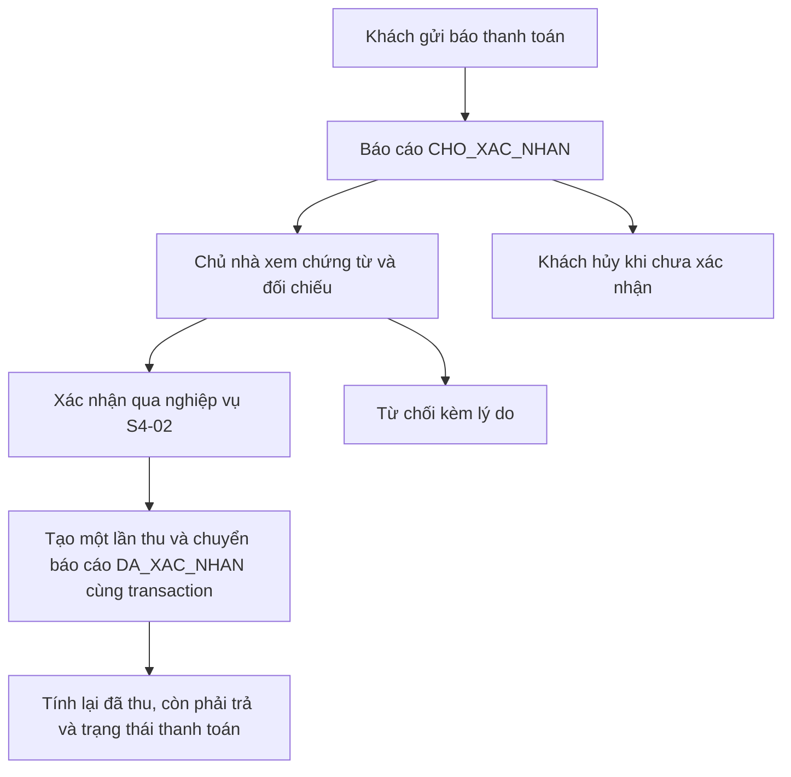

# Kế hoạch S4-01 / S4-02 — Báo thanh toán và xác nhận thu

Ngày lập: 13/10/2026. **Đây là kế hoạch bàn giao, chưa phải chức năng đã triển khai hay schema đã nâng cấp.**

> Cập nhật triển khai cùng ngày: S4-02 task 1–2 / AC1–AC4 có trong mã, xem [bàn giao ghi/hủy thu](S4-02-ghi-thu.md). v26 dùng metadata `lan_thu_hoa_don` một-một với `thanh_toan`; v27 thêm sự kiện hủy bất biến `huy_lan_thu_hoa_don`, không xóa/khôi phục lần thu. S4-01/bảng báo riêng chưa triển khai. Các phần dưới là kế hoạch phần còn lại, không tự tạo sổ tiền mới hoặc áp dụng schema dự kiến mà bỏ qua mã v27. Quyền hủy đã được người dùng chốt: chủ nhà có quyền tài chính/sở hữu hiện tại, không giới hạn người ghi hay thời gian; không mở cho QUAN_LY.

Đọc cùng [AGENTS.md](../AGENTS.md), [backlog gốc](01-yeu-cau-he-thong.md), [đối chiếu backlog](doi-chieu-backlog-20261012.md) và [tiến độ](tien-do.md). Nội dung dựa trên backlog S4-01…S4-09 người dùng cung cấp và đề xuất tách báo thanh toán ngày 13/10/2026. Không triển khai các story khác trong task S4-01/S4-02.

## 1. Quyết định nghiệp vụ và ranh giới story

**S4-01 là khách báo thanh toán; S4-02 là chủ nhà xác nhận tiền thực thu.** Báo cáo chờ xác nhận, bị từ chối hoặc đã hủy không làm tăng Tổng đã thu và không giảm công nợ.



| Phạm vi | S4-01 | S4-02 |
| --- | --- | --- |
| Khách | Gửi báo cáo, xem lịch sử và lý do từ chối, hủy báo cáo của mình đang chờ | Xem lần thu đã xác nhận |
| Chủ nhà | Xem hàng chờ, chứng từ; thao tác từ chối theo mục cần PO chốt | Xác nhận từ báo cáo hoặc ghi thu trực tiếp, nhiều lần, hủy lần thu ghi nhầm có lý do |
| Tác động tài chính | Không cộng tiền báo vào đã thu | Chỉ lần thu DA_XAC_NHAN được cộng; hủy tính lại dư nợ |

S4-01 có thể hoàn thành gửi/hủy trước, nhưng không được đánh dấu nghiệm thu luồng đầy đủ khi S4-02 chưa nối thật. Không tạo bản ghi thu giả khi khách gửi; không đưa báo cáo vào phép cộng tài chính.

## 2. Hiện trạng đã kiểm tra và chỗ lệch

- `Models/ThanhToanHoaDon.cs` ánh xạ `thanh_toan`: hiện chỉ có `id`, `hoa_don_id`, `so_tien`, `ngay_thanh_toan`, `trang_thai`. Chưa có hình thức, người xác nhận, chứng từ, khóa chống trùng hay quan hệ báo cáo.
- `Data/InvoicePaymentSchema.cs` là bước v23; tạo FK hóa đơn `ON DELETE RESTRICT`, số tiền dương và bốn trạng thái. **Giữ nguyên bước v23**, thêm bước mới khi triển khai.
- Đọc SQLite mặc định `QL_PhongTro/Data/local-dev.sqlite` bằng kết nối chỉ đọc ngày 13/10: max version = 25; bảng thanh toán khớp năm cột trên, có index hóa đơn/trạng thái. Không có `payment_report`, `bao_thanh_toan`, `giao_dich_coc`. Không chạy updater. Đây không chứng minh DB của web đang chạy giống DB mặc định.
- `ThongBaoController`, `HoaDonDichVuController.Management` và `HomeController` đã đọc tổng từ thanh toán `DA_XAC_NHAN`. Trang chủ chủ nhà hiện đếm khoản chờ từ `thanh_toan`; nếu tách bảng báo cáo phải đổi truy vấn này. Đọc tổng không phải chức năng ghi thu hoàn chỉnh.
- `ViewModels/ChiTietHoaDonKhachViewModel.cs` dùng `THANH_TOAN_MOT_PHAN`; giữ mã hiện có thay vì tự đổi thành `TRA_MOT_PHAN`.
- Backlog gốc và AGENTS mô tả một bảng `thanh_toan` chứa cả báo trả/xác nhận. Đề xuất mới tách hai lớp; kế hoạch này chọn **bảng báo riêng + bảng thu hiện có**, cần schema mở rộng có phiên bản. Không tự tạo bảng tiếng Anh `payment_report` song song mà bỏ qua quy ước dự án.
- Đối chiếu 12/10 ghi DB mặc định v16; đã khác quan sát v25 ngày 13/10. Các ghi chú “Sprint 3/4 chưa làm” trong AGENTS là lịch sử, phải kiểm tra mã và tiến độ mới trước mỗi task.

## 3. Công thức và trạng thái

```text
Đã thu = tổng thanh_toan.so_tien có trang_thai = DA_XAC_NHAN
Cấn cọc = tổng CAN_TRU đã xác nhận của đúng hóa đơn (khi S4-04 có sổ cọc)
Còn phải trả = Tổng hóa đơn - Đã thu - Cấn cọc
```

Không coi cấn cọc là tiền thu lần nữa. Không dùng max(…, 0) để che lỗi thu vượt; chặn giao dịch gây dư nợ âm. S4-03, S4-08, S4-09 và S4-04 phải dùng chung dịch vụ tính dư nợ để tránh mỗi màn hình tính một kiểu. Khi chưa có sổ cọc, ghi rõ chưa hỗ trợ cấn trừ, không tạo dữ liệu cọc giả.

Ba loại trạng thái độc lập:

| Loại | Mã / cách dùng |
| --- | --- |
| Chứng từ hóa đơn lưu DB | NHAP, DA_PHAT_HANH, DA_HUY — giữ nguyên |
| Báo thanh toán | CHO_XAC_NHAN → DA_XAC_NHAN / DA_HUY / TU_CHOI; trạng thái cuối không mở lại |
| Thanh toán hóa đơn suy ra | CHUA_THANH_TOAN, THANH_TOAN_MOT_PHAN, DA_THANH_TOAN; Quá hạn là cờ khi còn nợ và hôm nay VN > hạn |

Hiển thị “Chờ xác nhận” là khối/badge báo cáo, không ghi đè `hoa_don.trang_thai`. Hóa đơn trả một phần vẫn có thể quá hạn và có báo cáo chờ. Nếu bộ lọc cần một mã `QUA_HAN`, giữ tương thích mã hiện có và tính từ cờ quá hạn; không thêm trạng thái phát hành mới. Hóa đơn đã hủy hiện nhãn đã hủy và chặn thu/báo mới.

Tiền nhập là số nguyên đồng > 0, tính bằng decimal khi cần; ngày trả dùng DateOnly, không sau hôm nay Việt Nam qua ITimeProvider. Thời điểm gửi/xác nhận/hủy/từ chối lưu UTC; hiển thị dd/MM/yyyy HH:mm giờ VN, tiền `3.000.000 đ`. Hợp đồng đã kết thúc vẫn được trả nợ hóa đơn cũ đã phát hành.

## 4. Thiết kế dữ liệu dự kiến

Tên bảng dự kiến `bao_thanh_toan` (tương ứng payment_report trong đề xuất). Đây là hợp đồng thiết kế để review trước code, chưa phải DDL được phép chạy trên DB thật.

| Nhóm | Cột dự kiến |
| --- | --- |
| Định danh | id; hoa_don_id FK RESTRICT; khach_thue_id FK RESTRICT |
| Nội dung bất biến sau gửi | so_tien INTEGER; ngay_thanh_toan date; hinh_thuc TIEN_MAT/CHUYEN_KHOAN; khoa_tep_chung_tu nullable theo chính sách; ghi_chu |
| Trạng thái | trang_thai, phien_ban; khoa_chong_trung UNIQUE NOT NULL |
| Gửi/hủy | nguoi_gui_id (tài khoản); ngay_tao UTC; ngay_huy UTC; nguoi_huy_id |
| Xác nhận | ngay_xac_nhan UTC; nguoi_xac_nhan_id FK tài khoản |
| Từ chối | ngay_tu_choi UTC; nguoi_tu_choi_id FK tài khoản; ly_do_tu_choi |

Không nhận tenant_id, trạng thái, người xác nhận hay khóa tệp bất kỳ từ form làm nguồn tin cậy. Suy ra chủ thể từ tài khoản đăng nhập và quan hệ hóa đơn → hợp đồng → khách đứng tên. Giữ quyền đứng tên hiện có; không tự mở quyền báo tiền cho người ở ghép.

Mở rộng `thanh_toan`, giữ nguyên cột và bản ghi cũ: `bao_thanh_toan_id` nullable FK RESTRICT, **unique có điều kiện khi khác NULL**; hình thức, ngày/người xác nhận, khóa chống trùng, phiên bản, ngày/người/lý do hủy. Thu trực tiếp không cần báo cáo. Ràng buộc báo cáo và lần thu phải cùng hóa đơn; một báo cáo tối đa một lần thu, kể cả lần thu đã hủy.

Không suy đoán hình thức hoặc người xác nhận của khoản cũ: cột mới cho dữ liệu legacy có thể NULL, hiển thị “Chưa có thông tin”; bản ghi mới phải đủ dữ liệu. Nếu có khoản `CHO_XAC_NHAN` cũ, lập báo cáo kiểm kê trên bản sao và quyết định chuyển đổi riêng; không vừa chuyển thành báo mới vừa giữ nó trong hàng chờ cũ gây trùng. Bản báo đã xác nhận giữ trạng thái đó khi lần thu bị hủy, hiển thị thêm “Lần thu đã hủy”; không cho xác nhận báo này lần nữa.

Bước updater mới dùng phiên bản tiếp theo thực tế lúc triển khai (không mặc định v26 nếu đồng đội đã dùng). Backup, chạy trên bản sao sau khi dừng app liên quan, kiểm tra integrity/FK, schema/index, bảo toàn dữ liệu cũ, chạy lặp, khởi tạo DB rỗng. Không EnsureCreated/EnsureDeleted hay sửa bước cũ. Không commit DB/backup/chứng từ.

## 5. Màn hình và validation

### Khách thuê

Chi tiết hóa đơn hiển thị tổng, đã thu được xác nhận, cấn cọc nếu có, còn phải trả, hạn, lịch sử báo cáo và các lần thu. Nút “Báo đã thanh toán” ẩn khi chưa phát hành/đã hủy/đã hết nợ hoặc tổng báo đang chờ đã phủ dư nợ. Backend kiểm tra lại mọi điều kiện dù nút bị ẩn.

Modal/drawer gồm số tiền mặc định bằng dư nợ; ngày trả mặc định hôm nay VN; hình thức; ảnh JPG/PNG tối đa 5MB; ghi chú; Quay lại/Gửi báo thanh toán. Kiểm tra số nguyên, >0, không quá dư nợ, ngày không tương lai, dung lượng và nội dung ảnh phía server. Đề xuất chuyển khoản bắt buộc ảnh; chính sách tiền mặt ở mục 9 chưa được chốt.

Sau gửi: khối chờ hiển thị số tiền, ngày trả, hình thức, thời điểm gửi, trạng thái, nút hủy. Không có sửa báo cáo. Nút hủy chỉ khi báo của mình CHO_XAC_NHAN; hủy giữ bản ghi và chứng từ lịch sử. Không cấp quyền xem ảnh cho khách theo AC gốc: chỉ chủ nhà sở hữu và ADMIN xem ảnh. Khách vẫn thấy metadata của báo cáo mình.

### Chủ nhà / ADMIN

Trong chi tiết hóa đơn và danh sách hàng chờ: số tiền báo, ngày, hình thức, ghi chú, nút xem chứng từ, xác nhận đã thu, từ chối kèm lý do nếu PO duyệt. Danh sách có lọc tòa/trạng thái và phân trang; chỉ dữ liệu tòa của chủ nhà.

Xác nhận mở form S4-02 điền sẵn dữ liệu báo; người xác nhận lấy server từ phiên đăng nhập. Đề xuất xác nhận đúng toàn bộ số tiền báo, không âm thầm sửa báo cáo; nếu sai thì từ chối để khách gửi lại hoặc ghi thu trực tiếp có liên kết lịch sử phù hợp. Chính sách xác nhận số tiền khác báo cần PO chốt trước khi hỗ trợ.

S4-02 còn cần form ghi thu trực tiếp và hủy lần thu có lý do, giữ lịch sử. ADMIN chỉ đọc/xem chứng từ, không xác nhận/từ chối/hủy thu. QUAN_LY không truy cập TAI_CHINH. Giao diện tiếng Việt, theme hiện có, modal/drawer dùng được ở 360px và bàn phím.

## 6. Endpoint, quyền và chứng từ

Các route tiếng Anh người dùng nêu là gợi ý hợp đồng, không bắt buộc tạo thêm một API framework. Dùng MVC/Razor + service; có thể quy về action sau, thống nhất trước khi hai thành viên code:

| Hành động | Route MVC dự kiến | Chủ thể |
| --- | --- | --- |
| Gửi báo, đọc danh sách báo của hóa đơn | POST /BaoThanhToan/Gui; GET /BaoThanhToan/DanhSach?hoaDonId=… | Khách đứng tên |
| Hủy báo | POST /BaoThanhToan/Huy | Khách gửi báo đang chờ |
| Hàng chờ | GET /ThanhToan/ChoXacNhan?trangThai=CHO_XAC_NHAN | Chủ nhà; ADMIN chỉ đọc |
| Xác nhận / từ chối | POST /ThanhToan/XacNhanBao; POST /ThanhToan/TuChoiBao | Chủ nhà sở hữu |
| Ghi thu trực tiếp / hủy thu | POST /ThanhToan/GhiThu; POST /ThanhToan/HuyThu | Chủ nhà sở hữu |
| Cấp link / đọc chứng từ | GET /ChungTuThanhToan/LienKet; GET /ChungTuThanhToan/Xem | Chủ nhà sở hữu, ADMIN |

DTO mutations chứa id, phiên bản, khóa chống trùng và dữ liệu form cần thiết; không tin số dư gửi từ client. JSON trả kết quả cùng tổng tiền tính lại; input sai 400, chưa đăng nhập theo cơ chế MVC/API hiện có, trái quyền 403, xung đột 409 và yêu cầu tải lại. Không dùng PENDING trong truy vấn DB; ánh xạ về CHO_XAC_NHAN nếu cần alias API.

Khách hiện có quyền module TAI_CHINH READ + OwnDataOnly. Không nâng toàn vai trò lên WRITE chỉ để gửi báo. Thiết kế action tự phục vụ kiểm tra vai trò KHACH_THUE, module được phép truy cập và sở hữu cụ thể, tương thích cơ chế quyền hiện có; test quyền bị thu hồi NONE vẫn từ chối. Chủ nhà cần quyền ghi TAI_CHINH và sở hữu qua toa_nha.chu_nha_id. Mọi form POST có anti-forgery; API dùng cookie cũng phải chống CSRF.

Ảnh lưu ngoài wwwroot, khóa ngẫu nhiên nội bộ, chống path traversal; xác thực JPG/PNG bằng giải mã/chữ ký, không chỉ extension/MIME. Không nhận URL public từ client. Link có chữ ký hết hạn 15 phút, ràng buộc báo cáo và người xem; **lúc tải ảnh vẫn kiểm tra đăng nhập, quyền hiện tại, sở hữu và hạn**, trả no-store/nosniff. Không log URL ký, khóa tệp hay ghi chú tự do vào audit. Sao lưu DB phải kèm kho chứng từ.

Tệp và transaction SQL không nguyên tử chung: dùng vùng tạm, ghi tệp trước commit và dọn khi rollback; có kế hoạch dọn tệp mồ côi sau crash. Không xóa chứng từ lịch sử khi hủy/từ chối. S4-01 không được nghiệm thu upload chỉ bằng lưu ảnh public.

## 7. Chống trùng và ghi đồng thời — làm từ đầu

1. Gửi báo: khóa chống trùng duy nhất; retry cùng khóa/nội dung trả lại báo cũ, cùng khóa khác nội dung báo xung đột. Kiểm tra lại hóa đơn/dư nợ trong transaction. Không tự trừ tổng chờ khỏi dư nợ tài chính.
2. Xác nhận: mở transaction ghi SQLite theo cơ chế dự án; đọc lại báo đang chờ và phiên bản; kiểm tra quyền, hóa đơn phát hành, số tiền ≤ dư nợ hiện tại; tạo một lần thu, chuyển báo đã xác nhận, tăng phiên bản, ghi audit và commit cùng nhau.
3. Unique bao_thanh_toan_id bảo vệ bấm hai lần nhưng **không đủ chống hai báo khác nhau cùng thu vượt**. Ghi thu trực tiếp, xác nhận báo, hủy thu và cấn cọc tương lai phải cùng cơ chế serialize/check dư nợ theo hóa đơn. Không đọc nợ ngoài transaction rồi ghi sau.
4. Xác nhận đối đầu hủy/từ chối: cập nhật có điều kiện trạng thái + phien_ban, chỉ một thao tác thắng. Retry xác nhận đã thành công trả lần thu có sẵn; báo đã hủy/từ chối hoặc lần thu nguồn đã hủy thì không tạo thu mới.
5. Lỗi audit hoặc lưu DB rollback mọi thay đổi. Thêm entity vào allowlist audit hoặc ghi audit riêng theo cơ chế hiện có; chỉ ghi id, tiền, trạng thái, hình thức, ngày nghiệp vụ và người thao tác; không ghi ảnh/URL/ghi chú/lý do tự do. Xử lý database locked bằng thông báo/retry an toàn có giới hạn, không lặp tạo thu.

Tổng các báo chờ có được vượt dư nợ không là chính sách riêng còn chờ PO (mục 9). Dù chọn cách nào, xác nhận luôn chặn thu vượt sau khi tính lại nợ.

## 8. Thứ tự triển khai và bàn giao giữa thành viên

| Bước | Công việc / đầu ra bắt buộc |
| --- | --- |
| 0 | Đọc AGENTS, kế hoạch, mã/schema DB đích chỉ đọc; ghi nhánh/commit, version và chỗ lệch; chốt các câu hỏi ảnh và báo chờ trước phần phụ thuộc |
| 1 | Review hợp đồng DTO/service/schema; updater phiên bản mới + mapping + test nâng cấp bảo toàn dữ liệu trên bản sao |
| 2 | Dịch vụ dư nợ dùng chung, chống trùng/transaction/audit, kho ảnh private + link 15 phút; chưa mở giao diện nếu thiếu quyền |
| 3 | S4-01 gửi/đọc/hủy + test quyền, validation, tệp, đồng thời; form và lịch sử khách |
| 4 | Hàng chờ chủ nhà, xem chứng từ, từ chối nếu được chốt; cập nhật badge Home đang đọc bảng cũ |
| 5 | S4-02 ghi thu trực tiếp, xác nhận báo qua cùng service, hủy thu có lý do; cập nhật ngay số tiền/nhãn mọi màn hình |
| 6 | Chạy test tích hợp liên story và regression hóa đơn, quyền, trang chủ; nghiệm thu thủ công web 360px; ghi kết quả thật trong tiến độ |

Không để chống trùng/test đến cuối. Thành viên S4-01 bàn giao schema/DTO, hàm gửi-hủy, storage, test và lỗi còn lại. Thành viên S4-02 dùng cùng service dư nợ và schema, không tạo bảng thu thứ hai. Nếu làm trên nhánh riêng, đồng thuận một người sở hữu bước updater mới và merge nền trước, tránh trùng số phiên bản.

Các điểm nối backlog: S4-03 chỉ tính nợ từ khoản xác nhận/cấn cọc; S4-04 trả nợ cũ sau đóng hợp đồng, phối hợp khóa với cấn cọc; S4-08 nhắc hạn dựa dư nợ thực và không coi báo chờ là đã trả; S4-09 chỉ tính tiền thực thu, báo chờ không tăng doanh thu đã thu. Không tự triển khai các chức năng đó trong PR này.

## 9. Các điểm PO cần quyết định, không để AI tự chốt

| Câu hỏi | Đề xuất và phần bị ảnh hưởng |
| --- | --- |
| Tiền mặt có bắt buộc ảnh không? | Chuyển khoản bắt buộc ảnh; tiền mặt tùy PO. Chưa chốt thì chưa nghiệm thu luồng tiền mặt; có thể tiếp tục phần chuyển khoản |
| Có duyệt thao tác từ chối kèm lý do không? | Nên có để xử lý báo sai, khách thấy lý do và được gửi báo mới; không tự đánh dấu mở rộng AC này đã được PO duyệt |
| Nhiều báo chờ cùng hóa đơn có được tổng vượt dư nợ không? | Đề xuất tổng chờ ≤ dư nợ tại lúc gửi; khi đã có báo chờ, mặc định form bằng phần còn chưa được báo và hiển thị cả dư nợ thực lẫn tổng chờ. Đây là điều chỉnh so với mặc định bằng toàn dư nợ trong đề xuất ban đầu, cần PO duyệt |
| Chủ nhà xác nhận số tiền/ngày/hình thức khác báo được không? | Đề xuất xác nhận nguyên nội dung, sai thì từ chối/gửi lại; không sửa báo đã gửi |

Ghi quyết định PO có ngày và cập nhật AC/test trước triển khai phần phụ thuộc. Hai câu hỏi bổ sung về báo chờ và sửa số tiền xuất phát từ khoảng trống nghiệp vụ, không phải AC đã chốt.

## 10. Kiểm thử và điều kiện hoàn thành

| Ca | Kết quả cần đạt |
| --- | --- |
| Hóa đơn 3.000.000; báo 1.000.000 | Đã thu 0; còn trả 3.000.000; chờ 1.000.000 |
| Xác nhận báo trên | Một lần thu 1.000.000; còn 2.000.000; Trả một phần |
| Thu tiếp 2.000.000 | Đã thu 3.000.000; còn 0; Đã thanh toán; ẩn/chặn báo mới |
| Retry gửi/xác nhận, hai request đồng thời | Một báo/một lần thu đúng khóa; không tăng tiền lần hai |
| Hai báo khác nhau hoặc báo và thu trực tiếp cùng xác nhận | Không thu vượt; thao tác thua nhận xung đột/tải lại |
| Hủy/từ chối báo chờ | Giữ lịch sử; tiền không đổi; không xác nhận tiếp |
| Hủy báo đối đầu xác nhận | Chỉ một trạng thái cuối; không có báo hủy mà vẫn sinh thu |
| Hủy lần thu ghi nhầm 1.000.000 sau trả đủ | Có lý do/người/thời điểm; đã thu giảm còn 2.000.000, nợ lại 1.000.000; báo nguồn không xác nhận lại |
| Tiền 0, âm, lẻ đồng, vượt nợ; ngày tương lai | Backend từ chối, không tạo báo/thu/tệp mồ côi |
| Hóa đơn nháp/hủy/hết nợ | Chặn gửi và ghi thu, kể cả request giả |
| Hợp đồng kết thúc nhưng còn nợ cũ | Được báo/thu cho hóa đơn cũ thuộc mình đã phát hành |
| Khách khác/chủ nhà khác/QUAN_LY/ADMIN ghi | 403; ADMIN chỉ đọc; quyền module NONE bị chặn |
| Ảnh giả, >5MB, đường dẫn độc hại | Từ chối phía server; không lưu public |
| Link chứng từ đúng/sai người/hết 15 phút/thu hồi quyền | Chỉ chủ nhà đúng phạm vi và ADMIN còn quyền được xem; no-store |
| Lỗi audit/commit/storage | Rollback đúng, không có báo xác nhận thiếu thu hoặc thu thiếu audit; dọn tệp mới |
| Cấn cọc 500.000 + đã thu 1.000.000 trên tổng 3.000.000 | Khi sổ cọc có: nợ 1.500.000; không cộng cọc vào tiền thu lần hai |
| Nâng cấp dữ liệu cũ/rerun/DB rỗng | Bảo toàn bản ghi, không suy đoán metadata cũ, integrity/FK đạt |

Test liên quan sẵn có: `InvoiceTenantBalanceTests`, `PermissionTests.TenantHomeInvoices`, test schema v23; thêm test service/HTTP thật cho phân quyền, CSRF, rollback và race, không chỉ test cộng tiền. Chỉ build sau khi dừng app theo AGENTS; chạy test trên DB tạm/bản sao. Lệnh dự kiến: `dotnet build QL_PhongTro/QL_PhongTro.csproj -c Debug --no-restore`, `dotnet test Tests/QL_PhongTro.Tests/QL_PhongTro.Tests.csproj --no-restore` (chọn filter liên quan trước, mở rộng khi cần).

Hoàn thành khi AC được ghi kết quả, review và merge theo DoD; giao diện khách/chủ nhà 360px, định dạng và quyền đạt; schema được kiểm chứng; tiến độ ghi test đã chạy và phần chưa kiểm chứng. **Tài liệu này chưa chạy build/test chức năng vì không sửa mã.**

## 11. Mẫu giao việc cho AI tiếp theo

> Đọc hết AGENTS.md và docs/ke-hoach-S4-01-S4-02.md. Triển khai [S4-01 hoặc S4-02, phạm vi cụ thể]. Kiểm tra git status, mã và schema DB đích chỉ đọc trước khi sửa; báo rõ lệch. Không chạy updater trên DB đang dùng, không sửa bước v23 hay ghi đè dữ liệu. Báo thanh toán riêng không cộng vào đã thu; chỉ lần thu DA_XAC_NHAN giảm nợ. Dùng chung dịch vụ dư nợ/transaction/chống trùng/audit; kiểm tra quyền và CSRF phía server. Đọc quyết định PO mục 9, hỏi phần còn thiếu và tiếp tục phần độc lập. Giữ thay đổi của đồng đội, không stage DB hoặc project test ngoài phạm vi. Kết thúc bằng kết quả kiểm thử thật, giới hạn nghiệm thu và cập nhật tiến độ; không đánh dấu hoàn thành chỉ vì có bảng/model.
